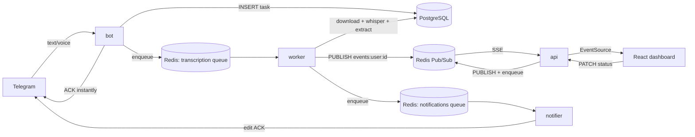

# AI Task Bot

Omni-channel task management: create tasks in Telegram by text or voice, watch them appear
live on a Kanban dashboard, and update status from either side.

## Requirement → implementation matrix

| Requirement | Where |
|---|---|
| Telegram Bot API | [`backend/app/bot/`](backend/app/bot) (aiogram 3, long polling) |
| Text messages → task | [`bot/handlers.py`](backend/app/bot/handlers.py) → [`ai/extractor.py`](backend/app/ai/extractor.py) → [`services/tasks.py`](backend/app/services/tasks.py) |
| Voice messages → Whisper transcription | [`ai/transcriber.py`](backend/app/ai/transcriber.py) (`faster-whisper`, CTranslate2) run in [`worker/transcription.py`](backend/app/worker/transcription.py) |
| PostgreSQL persistence | [`db/models.py`](backend/app/db/models.py), Alembic migrations in [`backend/alembic/`](backend/alembic) |
| Redis as broker/queue | [`queue/client.py`](backend/app/queue/client.py) (arq): `transcription` and `notifications` queues |
| Responsive Kanban dashboard | [`web/src/components/Board.tsx`](web/src/components/Board.tsx) (React 19 + `@dnd-kit`) |
| Realtime updates on new task | Redis Pub/Sub → SSE: [`services/events.py`](backend/app/services/events.py), [`api/routes/events.py`](backend/app/api/routes/events.py), [`web/src/hooks/useEventStream.ts`](web/src/hooks/useEventStream.ts) |
| Status toggles (Pending / In Progress / Completed) | `PATCH /api/tasks/{id}` ([`api/routes/tasks.py`](backend/app/api/routes/tasks.py)), drag-and-drop + buttons on `TaskCard` |
| Dockerized, `docker-compose.yml` orchestrates web/api/db/redis/worker | [`docker-compose.yml`](docker-compose.yml), [`backend/Dockerfile`](backend/Dockerfile), [`web/Dockerfile`](web/Dockerfile) |
| Resilient voice error handling | ACK message, internal timeout, retries with backoff, `failed` status + manual retry, reconciler — see [Voice pipeline](#voice-pipeline--resilience) |
| Effective use of Redis queues | separate `transcription` (`max_jobs=1`) and `notifications` (`max_jobs=20`) queues so slow STT never blocks fast notifications |
| Speed of transcription feedback | bot ACKs "🎤 Распознаю…" in under a second, before any download/transcription happens |

## Architecture



Modular monolith, one Python package, four stateless entry points (`api`, `bot`, `worker`,
`notifier`) sharing a `services` layer. All state lives in Postgres and Redis, so any process
can restart or scale independently.

## Quickstart

```bash
cp .env.example .env        # fill in TELEGRAM_BOT_TOKEN and JWT_SECRET
make up                     # builds images, runs migrations, starts everything
```

Open `http://localhost:8080`, message the bot `/login`, follow the link.

| Env var | Meaning |
|---|---|
| `TELEGRAM_BOT_TOKEN` | bot token from @BotFather |
| `DATABASE_URL` / `REDIS_URL` | compose service DNS names by default |
| `JWT_SECRET` | ≥32 chars, signs the session cookie |
| `WEB_URL` | used to build magic-login links |
| `COOKIE_SECURE` | `false` in dev (no HTTPS), `true` in prod |
| `APP_TZ` | timezone used to interpret relative dates ("завтра в 10") |
| `TRANSCRIBER` | `faster_whisper` \| `openai` \| `fake` |
| `WHISPER_MODEL`, `WHISPER_THREADS` | STT model size / CPU threads |
| `VOICE_MAX_SEC` | reject voice notes longer than this |
| `EXTRACTOR` | `rules` \| `llm` \| `fake` |
| `OPENAI_API_KEY` | only needed for `TRANSCRIBER=openai` or `EXTRACTOR=llm` |

## Voice pipeline & resilience

1. Bot replies "🎤 Распознаю…" immediately and remembers that message's id — no download
   happens on the bot's critical path, so feedback is near-instant.
2. Task is inserted as `queued` with the Telegram file id; the file itself is never put on
   the queue, only its id — the worker re-downloads it on every attempt, so there's no shared
   volume and retries are always possible.
3. Worker transcribes (`faster-whisper`, internal 90s timeout under arq's 120s job timeout so
   a stuck job surfaces as a normal exception, not a silent hang) and extracts structured
   fields (dates, tags, priority) via rules or an LLM.
4. On failure: retried up to 3 times with exponential backoff; after that the task becomes
   `failed` with an error message, and the dashboard/bot offer a manual retry
   (`POST /api/tasks/{id}/retry`).
5. A cron reconciler runs every minute and re-enqueues tasks stuck in `queued`/`processing`
   for more than 5 minutes (covers a worker crash or an enqueue that never happened), capping
   total attempts (reconciler + manual retry share one counter) at 6 before marking `failed`. This is deliberately simpler than a
   transactional outbox, which would be overkill at this scale.
6. If Redis is down when a voice note arrives, the ACK is edited to "Сервис перегружен" and
   the task stays `queued` for the reconciler to pick up once Redis returns.

An empty transcript fails immediately with a "no speech" message (no retry). Text
extraction is bounded to 3s with a title-only fallback. Audit rows are written to
`task_events`.

## Validation limits

`title` 1–200 chars, `description` ≤ 2000, `tags` ≤ 10 × 50 chars, `raw_text` ≤ 4000;
explicit `null` for `title`/`status`/`priority`/`tags` in PATCH → 422; `GET /api/tasks`
takes `limit` (1–500, default 200).

## Key decisions

| Question | Decision | Why |
|---|---|---|
| Queue | arq (Redis) | asyncio-native, retry/timeout/job_id/cron built in |
| Workers | separate `worker` (transcription, 1 job at a time) and `notifier` (20 jobs) | slow STT never blocks fast notifications; STT scales by worker replicas, not threads |
| STT | `faster-whisper small`, int8, VAD by default; OpenAI behind a flag | no API key required out of the box; same underlying Whisper model |
| Audio transfer | only the Telegram file id is queued, worker downloads it | no shared volume, fast ACK, retries just re-download |
| Structuring | rule-based (`dateparser` + keywords + `#tags`) by default; LLM behind a flag | deterministic and testable without an API key |
| Realtime | Redis Pub/Sub → SSE | server→client only, browser reconnects itself, scales across API replicas |
| Auth | Telegram magic-link → httpOnly JWT cookie | no password to phish; same-origin cookie works for both `fetch` and `EventSource` |
| Failure model | `failed` status + manual retry + reconciler | true task state lives in Postgres, not a separate DLQ |
| Time | `APP_TZ=Asia/Yerevan`, all timestamps `timestamptz` | "tomorrow at 10" means 10:00 Yerevan time |

## Out of scope (deliberate)

Kubernetes, Terraform, Telegram webhook mode, transactional outbox, SSE event replay,
attachments other than voice.

## Scaling this further

- Bot: switch long polling to a webhook behind the API once there's a public HTTPS endpoint.
- Worker: add replicas; `faster-whisper` scales horizontally, not by threads per process.
- SSE: currently one Redis subscription per connection; at higher scale, move to one
  `PSUBSCRIBE` per API process fanning out to in-memory per-connection queues.
- Dual-write (DB commit + enqueue): currently covered by the reconciler; a transactional
  outbox table would remove the polling delay if that mattered.

## Development

```bash
make up       # dev stack (publishes db/redis/api/web ports)
make up-prod  # base compose only: no ports published for db/redis/api
make test     # backend tests on isolated `app_test` DB and Redis db 15
make lint     # ruff + mypy + oxlint + tsc
make fmt      # ruff format + oxlint --fix
make logs     # follow all services
make down     # stop containers, keep data
make clean    # stop and remove volumes
```

CI (`.github/workflows/ci.yml`) runs lint, backend tests against real Postgres/Redis, a
Docker build of every image target, and `gitleaks`.
